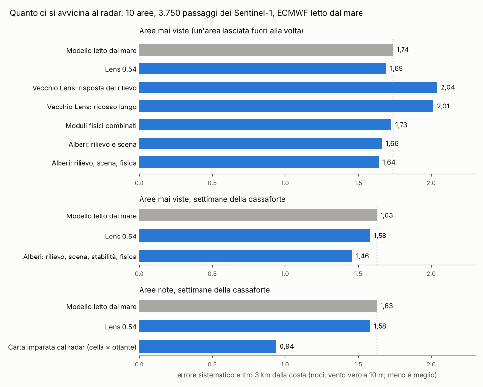

# Lens: quanto ci si avvicina al radar senza il radar (studio della notte 24-25/11/2026)

## La domanda

Giano: avvicinarsi il più possibile al vento che vede il radar, **senza usare il radar**: statistica, fisica del flusso sul rilievo, tutto quello che serve. E capire che cosa vale anche per coste mai studiate.

Le regole della prova:
- **Il radar fa da maestro e da giudice, mai da ingrediente.** Il metodo prende solo il GRIB già scaricato, il rilievo e l'ora.
- **Due prove di generalità:**
  - un'area lasciata fuori alla volta: si impara sulle altre nove e si giudica su quella;
  - la **cassaforte**: una settimana su cinque (il 20%, sparso su tutte le stagioni), mai usata fino alla prova finale.

## I dati

- **Radar:** Sentinel-1A e 1C (prodotto CMEMS L3 a 0,01°), 10 aree, 3.750 passaggi da giugno 2024 a novembre 2026, alle 05 e alle 17 UTC.
- **Modello:** ECMWF a 0,25° (dati aperti), letto dai soli punti di mare come in Shift 0.54.
- **La tabella:** 4,1 milioni di celle-passaggio entro 25 km dalla terra, con il modello oltre 6 nodi.
- **Per ogni cella:**
  - il rilievo intorno per la direzione del vento: terra e quota sopravvento, angolo del rilievo, valli e selle (creste sulle linee parallele), terra davanti e ai lati;
  - Lens 0.54 e i suoi pezzi uno per uno (risposta del rilievo, ridosso lungo, fascia costiera);
  - lo strato marino (sotto);
  - la scena: vento al largo, ora, stagione;
  - la stabilità da ECMWF: mare, 2 m, 925 e 850 hPa, vento a 100 m, raffica. Sono 1.813 file scaricati gratis dalle macchine di GitHub.

**Il metro.** Il radar sbaglia da solo di 3-4 nodi su una cella. L'errore quadratico è quindi fatto quasi tutto di rumore, e una correzione giusta lo sposta di poco. Il numero che conta è l'**errore sistematico**: lo scarto che si ripete nella stessa cella con la stessa direzione del vento, tolto il rumore del radar. È quello che Lens può correggere.

## 1. Il radar non misura il vento vero

Il radar misura il **vento neutro equivalente**: il vento che ci sarebbe se l'aria fosse neutra.
- Con aria più fredda del mare (il caso più comune) è più forte del vento vero.
- Con aria più calda del mare è più debole.

Con la stabilità di ECMWF l'ho convertito in vento vero a 10 m (`vento_vero.py`, formule di Monin-Obukhov):

| Aria 2 m − mare | Radar ÷ modello al largo (vento neutro) | Vento vero ÷ modello |
|---|---|---|
| sotto −3 K | 1,08 | 1,03 |
| da −3 a −1,5 K | 1,08 | 1,03 |
| da −1,5 a −0,5 K | 1,04 | 1,01 |
| da −0,5 a +0,5 K | 1,02 | 1,00 |
| sopra +0,5 K | 0,95 | 0,97 |

- **L'errore medio di ECMWF scende da −0,51 a −0,10 nodi.** Il "mezzo nodo in meno" dei confronti precedenti era quasi tutto il modo di misurare del radar.
- **Da qui in poi il bersaglio è il vento vero,** quello che si sente in barca.
- Il confronto della chat di Shift (`routing/atlante_costa_risultati.md`) era fatto sul vento neutro: i suoi numeri assoluti vanno letti con questo in mente.

## 2. I metodi a confronto

**Aree mai viste,** un'area lasciata fuori alla volta, fuori dalla cassaforte. Vento vero, nodi:

| Metodo | Errore quadratico | Sistematico | Sistematico entro 3 km | 3-10 km |
|---|---|---|---|---|
| Modello letto dal mare (Shift 0.54) | 3,575 | 1,082 | 1,738 | 1,174 |
| Fattore costante | 3,577 | 1,093 | 1,760 | 1,191 |
| **Lens 0.54** | **3,556** | **1,063** | **1,693** | **1,153** |
| Lens: solo la fascia costiera | 3,557 | 1,063 | 1,704 | 1,154 |
| Lens con ridosso più forte (0,45) e fascia costiera 0,4 | 3,560 | 1,076 | 1,718 | 1,166 |
| Vecchio Lens: risposta del rilievo | 3,632 | 1,244 | 2,040 | 1,361 |
| Vecchio Lens: ridosso lungo | 3,641 | 1,297 | 2,013 | 1,433 |
| Moduli fisici combinati (7 numeri) | 3,556 | 1,076 | 1,728 | 1,179 |
| Alberi: rilievo e scena | 3,566 | 1,098 | 1,664 | 1,178 |
| Alberi: rilievo, scena, moduli fisici | **3,539** | **1,027** | **1,642** | **1,128** |
| Alberi: rilievo, scena, stabilità | 3,585 | 1,112 | 1,679 | 1,189 |
| Alberi: rilievo, scena, stabilità, moduli fisici | 3,562 | 1,044 | 1,646 | 1,131 |

"Alberi" sono alberi di decisione potenziati (gradient boosting). Imparano un fattore per il vento del modello da tutte le caratteristiche insieme, senza sapere in che area sono.

**La prova finale (cassaforte):**

| Metodo | Sistematico | Entro 3 km |
|---|---|---|
| **Aree mai viste, settimane mai viste** | | |
| Modello letto dal mare | 0,972 | 1,626 |
| Lens 0.54 | 0,950 | 1,581 |
| Alberi: rilievo, scena, stabilità, moduli fisici | 0,981 | **1,460** |
| **Aree note, settimane mai viste** | | |
| Modello letto dal mare | 0,972 | 1,626 |
| Lens 0.54 | 0,950 | 1,581 |
| **Carta imparata dal radar** (area × cella × ottante, tirata verso la media dove i passaggi sono pochi) | **0,623** | **0,937** |

## 3. Che cosa dicono i numeri

1. **Lens 0.54 regge.** Sul vento vero è il migliore dei metodi solo fisici, sia sulle aree mai viste sia nella cassaforte.
   - I pezzi tolti nella 0.54 (risposta del rilievo, ridosso lungo) restano dannosi anche sul vento vero.
   - Un ridosso più forte (0,45) peggiora: la 0.54 resta com'è.
2. **Le regole statistiche sul solo rilievo non passano da una costa all'altra.** Gli scarti forti sono legati al posto:
   - il getto dello Stretto di Messina;
   - gli sbocchi delle valli a Genova;
   - il ridosso del golfo di Cagliari;
   - le scie dell'Elba.

   Dieci aree sono troppo poche perché una regola generale li impari tutti.
3. **I moduli fisici aiutano gli alberi.** Con loro, sulle aree mai viste, l'errore sistematico entro 3 km scende del 5-10%: da 1,74 a 1,64, e nella cassaforte da 1,63 a 1,46. È un guadagno vero ma piccolo.
4. **La stabilità serve a convertire il radar, non come ingrediente.** Tolto l'effetto del vento neutro, quel che resta della stabilità è diverso da area ad area, e gli alberi non lo trasferiscono.
5. **La carta imparata dal radar per area è un'altra cosa:** −36% di errore sistematico, −42% entro 3 km, su settimane mai viste.
   - Il tetto stimato a parte, imparando su metà delle settimane e provando sull'altra metà, è lo stesso: da 1,07 a 0,81.
   - **Eccezione: Palermo.** Lì la carta non migliora nella cassaforte: entro 3 km 2,55 contro 2,55, con l'errore quadratico un po' peggiore. Lo scarto di Palermo cambia da settimana a settimana: brezze, ore dei passaggi, l'angolo strano verso Capo Zafferano. Non è una correzione fissa.

## 4. Lo strato marino: la "fluidodinamica" sul rilievo

`strato_marino.py`.
- **Il modello.** Le equazioni delle acque basse per lo strato d'aria fresca sotto l'inversione (gravità ridotta). Griglia di 1,2 km, attrito uguale su terra e mare.
- **La risposta.** Si calcola sul rilievo fine e su quello liscio di un modello globale, e si legge dai punti di mare come Shift. Il rapporto tra le due è la correzione.
- **Costo:** 15-40 secondi per area e direzione sul computer di lavoro.
- **Dove si vede:**
  - **Messina:** con la tramontana fa il getto nello Stretto e il ventaglio a sud, come il radar, ma troppo forte e un po' spostato (correlazione 0,48);
  - **Cagliari:** con il maestrale fa il ridosso del golfo (0,54-0,61).
- **Dove sbaglia:**
  - **Palermo:** con il ponente blocca troppo e mette tutto il golfo in calma, mentre il radar vede solo −10%;
  - **Genova:** gli sbocchi delle valli non cadono nei posti giusti.
- **Il motivo:** uno strato solo, con spessore e inversione fissi (700 m, Froude 1), è troppo rigido. In realtà l'aria in parte scavalca.
- **Da solo non migliora le aree mai viste.** Come ingrediente degli alberi, insieme ai pezzi di Lens, sì: è da lì che viene il passo da 1,10 a 1,03.
- **Il prossimo passo,** se si vuole insistere: spessore e Froude per scena, dalla stabilità di ECMWF (925 hPa), invece di un regime solo.

## 5. Che cosa propongo

1. **Il metro, da ora, è il vento vero** (`vento_vero.py`). Vale per Lens e anche per gli atlanti della costa di Shift.
2. **Lens 0.54 resta il motore fisico.** Lo studio non trova regolazioni dei suoi pezzi che vadano meglio su aree mai viste.
3. **Per le aree prestabilite, la carta imparata dal radar.** È il passo che rende di più, di gran lunga.
   - Si calcola una volta, qui, e nell'app diventa un piccolo file per area: un fattore per cella e direzione. Nell'app il radar non serve.
   - **Usa però il radar per imparare,** ed è giusto dirlo chiaramente. Se "senza il radar" vuol dire anche questo, la strada resta quella degli alberi, che oggi vale 5-10%.
   - Il radar copre tutte le coste del Mediterraneo. La stessa carta si può fare per **grandi fasce costiere**, con gli alberi dove i passaggi sono pochi.
4. **Le carte valgono per un modello.** Queste sono per ECMWF letto dal mare. Per ICON-2I, il modello che Giano usa di più vicino a Palermo, ne serve una sua, dalla storia di ICON-2I (Open-Meteo, da aprile 2025).
5. **Palermo va studiata a parte.**
   - ICON-2I invece di ECMWF.
   - Le stazioni a terra per le brezze.
   - Un controllo dell'angolo verso Capo Zafferano, rosso con tutte le direzioni: fenomeno vero o difetto del radar sotto costa.
6. **Gli alberi nell'app per ora no.** Il guadagno sulle coste nuove (5-10% entro 3 km) non vale ancora il lavoro di portarli in Kotlin. Si rivaluta con più aree.

## 6. Limiti

- **Il radar passa solo alle 05 e alle 17 UTC.** Le termiche del primo pomeriggio non ci sono.
- **Il radar sotto costa (primo chilometro) può avere difetti suoi.** Non si distinguono da un fenomeno vero senza stazioni.
- **Dieci aree.** Le stime per area sono rumorose: nella cassaforte qualche area ha pochi gruppi di passaggi.
- **La conversione in vento vero usa la stabilità di ECMWF,** che vicino alla costa è approssimata.

## File

Codice in `banco/strumenti/`:
- `tabella_celle.py`: la tabella;
- `confronto_metodi.py`: i metodi e le prove;
- `vento_vero.py`: la conversione del radar;
- `stabilita.py`: la stabilità dai dati aperti;
- `strato_marino.py`, `atlante_strato.py`: lo strato marino;
- `carte_atlante.py`, `figura_metodi.py`: le figure.

Figure in `banco/figure/`: `metodi_a_confronto.png`, `atlante_radar_{palermo,messina,genova}.png`. Numeri completi, area per area, in `banco/risultati/confronto_*.json`; le righe di tutte le prove in `banco/risultati/righe_dei_confronti_25_11.txt`.
